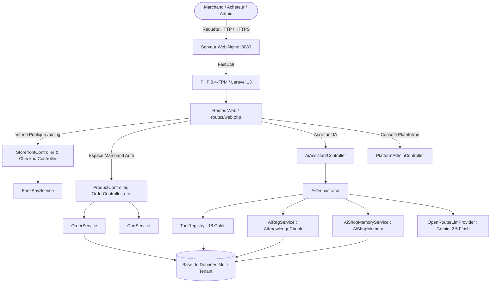
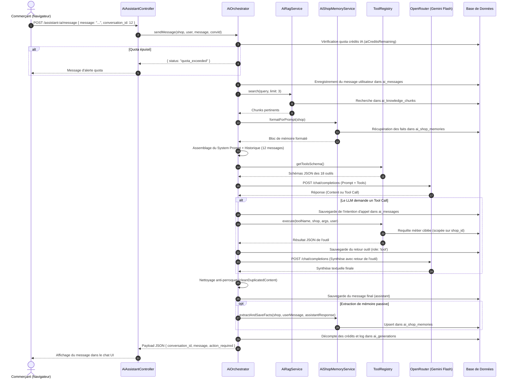
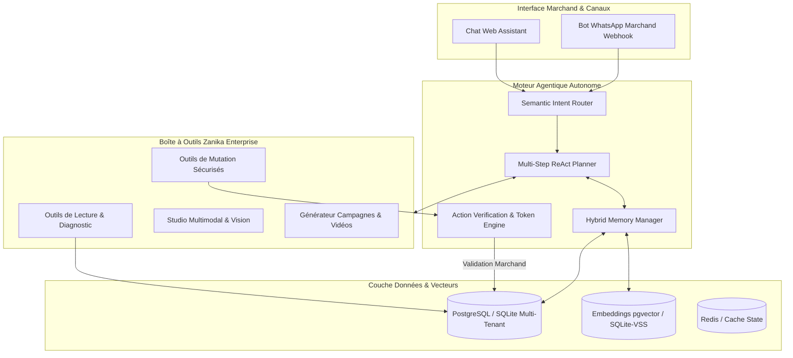
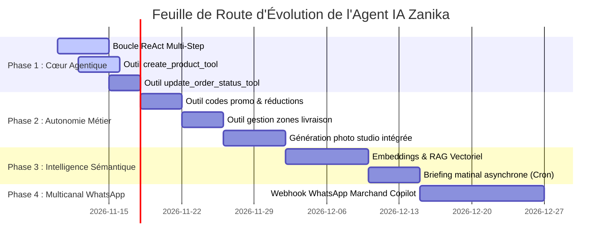

# AUDIT TECHNIQUE ET FONCTIONNEL COMPLET DE LA PLATEFORME ZANIKA
## Spécialisation et Élévation de l'Agent IA en Copilote E-Commerce Autonome

*Document de référence architecturale et stratégique*  
*Date de réalisation : Novembre 2026*  
*Auteur : Architecte Logiciel Senior & Expert en Systèmes Autonomes IA*  
*Statut du document : Version Finale de Référence (Audit Lecture Seule - Aucune altération du code existant)*

---

## SOMMAIRE EXÉCUTIF

1. [Présentation technique de Zanika](#1-présentation-technique-de-zanika)
2. [Architecture générale](#2-architecture-générale)
3. [Cartographie complète des modules](#3-cartographie-complète-des-modules)
4. [Audit approfondi de l'agent IA existant](#4-audit-approfondi-de-lagent-ia-existant)
5. [Parcours technique d'une requête IA](#5-parcours-technique-dune-requête-ia)
6. [Inventaire des API, services et outils disponibles](#6-inventaire-des-api-services-et-outils-disponibles)
7. [Analyse des règles métier](#7-analyse-des-règles-métier)
8. [Analyse des permissions et de la sécurité](#8-analyse-des-permissions-et-de-la-sécurité)
9. [Capacités actuelles de l'agent](#9-capacités-actuelles-de-lagent)
10. [Fonctionnalités IA manquantes](#10-fonctionnalités-ia-manquantes)
11. [Architecture cible recommandée](#11-architecture-cible-recommandée)
12. [Liste des améliorations prioritaires](#12-liste-des-améliorations-prioritaires)
13. [Plan d'implémentation progressif](#13-plan-dimplémentation-progressif)
14. [Risques techniques et recommandations](#14-risques-techniques-et-recommandations)

---

## 1. PRÉSENTATION TECHNIQUE DE ZANIKA

### 1.1 Mission et Positionnement Stratégique
**Zanika** est une plateforme SaaS e-commerce souveraine, conçue sur-mesure pour les commerçants et entrepreneurs d'Afrique de l'Ouest (Togo, Bénin, Côte d'Ivoire, Sénégal, Burkina Faso, etc.). Contrairement aux solutions généralistes occidentales (Shopify, WooCommerce), Zanika intègre nativement les réalités économiques et d'usages locales :
- Forte prépondérance du **Paiement à la Livraison (Cash on Delivery - COD)** représentant plus de 75% du volume transactionnel.
- Écosystème de **Mobile Money** ultra-dominant (T-Money Mixx by Yas, Moov Flooz, MTN MoMo, Wave, Orange Money).
- Canal relationnel et logistique pivot centré sur **WhatsApp** et les réseaux de coursiers urbains (conducteurs de motos, *zemidjans*, *kékénons*).
- Gestion assistée par Intelligence Artificielle pour pallier la fracture numérique des marchands locaux.

### 1.2 Pile Technologique Réelle (Stack Applicative)

| Couche | Technologie / Framework | Version identifiée | Fichiers de configuration clés |
| :--- | :--- | :--- | :--- |
| **Backend** | PHP | `^8.3` (Support Docker PHP 8.4-FPM) | [composer.json](file:///c:/Users/kougn/Desktop/shopify/plateforme/composer.json) |
| **Framework Web** | Laravel Framework | `13.17.*` | [bootstrap/app.php](file:///c:/Users/kougn/Desktop/shopify/plateforme/bootstrap/app.php) |
| **Frontend & UI** | Blade Templates + Tailwind CSS + Vite | Tailwind v4 (`@tailwindcss/vite`), Vite 8 | [package.json](file:///c:/Users/kougn/Desktop/shopify/plateforme/package.json), [vite.config.js](file:///c:/Users/kougn/Desktop/shopify/plateforme/vite.config.js) |
| **Base de données** | SQLite (Dev local) / PostgreSQL ou MySQL (Production) | SQLite 3 / MySQL 8.0 / PostgreSQL | [config/database.php](file:///c:/Users/kougn/Desktop/shopify/plateforme/config/database.php), [docker-compose.yml](file:///c:/Users/kougn/Desktop/shopify/plateforme/docker-compose.yml) |
| **Passerelle Paiement** | FeexPay SDK & API v2 REST | API REST v2 (Mode SANDBOX & LIVE) | [app/Services/FeexPayService.php](file:///c:/Users/kougn/Desktop/shopify/plateforme/app/Services/FeexPayService.php) |
| **Fournisseur LLM** | OpenRouter AI | API Chat Completions REST | [app/Services/Ai/Providers/OpenRouterLlmProvider.php](file:///c:/Users/kougn/Desktop/shopify/plateforme/app/Services/Ai/Providers/OpenRouterLlmProvider.php) |
| **Modèle LLM Défaut**| `google/gemini-2.5-flash` | Modèle multimodale rapide | [config/services.php](file:///c:/Users/kougn/Desktop/shopify/plateforme/config/services.php) |
| **Génération Image** | Pollinations AI (Flux Model) | API REST HTTP sans clé | [app/Services/Ai/AiVisionService.php](file:///c:/Users/kougn/Desktop/shopify/plateforme/app/Services/Ai/AiVisionService.php#L284) |
| **Conteneurisation** | Docker & Docker Compose | Nginx Alpine + PHP 8.4-FPM + Mailpit | [docker-compose.yml](file:///c:/Users/kougn/Desktop/shopify/plateforme/docker-compose.yml), [Dockerfile](file:///c:/Users/kougn/Desktop/shopify/plateforme/Dockerfile) |

### 1.3 Clarification Critique d'Architecture (Dépôt Hybride)
Une analyse rigoureuse du répertoire racine met en évidence deux sous-dossiers :
- `backend/` : Projet Node.js / TypeScript / Express / Prisma (`@prisma/client 5.22`, `express 5.2`, modules `students`, `teachers`, `attendance`, `courses`).
- `frontend/` : Projet React / TypeScript / Vite (`react-router-dom`, composants `Grades`, `Students`, `Billing`).

> [!IMPORTANT]
> **Observation formelle d'audit :** Les répertoires `backend/` et `frontend/` contiennent les sources d'une application de gestion scolaire tierce, complètement distincte du cœur e-commerce. La plateforme **Zanika** est intégralement et exclusivement contenue dans l'application Laravel (`app/`, `resources/views/`, `routes/web.php`, `database/`, etc.). L'ensemble de cet audit se concentre donc rigoureusement sur l'application Laravel active.

---

## 2. ARCHITECTURE GÉNÉRALE

### 2.1 Modèle Architectural Global
Zanika adopte une architecture monolithique modulaire moderne sous Laravel 13, tirant parti des principes de Domain-Driven Design (DDD) allégé :
1. **Couche Présentation (Storefront & Dashboard) :** Moteur de templates Blade avec composants modulaires, enrichis en micro-interactions JavaScript Vanilla et Tailwind CSS v4.
2. **Couche Contrôleurs (HTTP Layer) :** Contrôleurs spécialisés par domaines fonctionnels dans [app/Http/Controllers/](file:///c:/Users/kougn/Desktop/shopify/plateforme/app/Http/Controllers/).
3. **Couche Services Métier (Domain Services) :** Encapsulation de la logique opérationnelle complexe (création de commandes, annulation avec remise en stock, calculs de risque COD, communication FeexPay, notifications WhatsApp).
4. **Couche ECOM AI Orchestrator :** Système agentique articulé autour de `AiOrchestrator`, un `ToolRegistry` dynamique, un service RAG (`AiRagService`) et une mémoire vectorielle/sémantique relationnelle (`AiShopMemoryService`).
5. **Couche Modèles & Persistance :** Eloquent ORM couplé à des scopes globaux pour garantir l'isolation des données marchandes.



### 2.2 Modèle Multi-Tenant et Isolation des Données
La plateforme utilise une architecture **Single-Database Multi-Tenant** avec partitionnement logique par clé étrangère `shop_id`.

#### Mécanisme d'isolation : `BelongsToShopScope`
Implémenté dans [app/Models/Scopes/BelongsToShopScope.php](file:///c:/Users/kougn/Desktop/shopify/plateforme/app/Models/Scopes/BelongsToShopScope.php#L14) :
```php
class BelongsToShopScope implements Scope
{
    public function apply(Builder $builder, Model $model): void
    {
        if (Auth::check() && Auth::user()->isMerchant() && Auth::user()->shop) {
            $builder->where($model->qualifyColumn('shop_id'), Auth::user()->shop->id);
        }
    }
}
```
Ce scope est attaché aux modèles métiers : `Product`, `Category`, `Order`, `Customer`, `ShippingZone`, `Advertisement`, `StockMovement`.

> [!WARNING]
> **Alerte d'Architecture & Sécurité (Gotcha Critique) :**
> `BelongsToShopScope` ne s'applique que sous la condition `Auth::check() && Auth::user()->isMerchant() && Auth::user()->shop`.
> - Si un utilisateur a le rôle `admin`, le scope ne filtre **pas**.
> - Lors de requêtes exécutées hors session HTTP marchand (commandes CLI `artisan`, jobs asynchrones en queue, webhooks FeexPay), le scope ne filtre **pas**.
> - En conséquence, **tout outil IA manipulé par l'agent doit impérativement forcer la clause explicite `where('shop_id', $shop->id)`**, ce que le code existant respecte scrupuleusement mais qui doit demeurer une règle infranchissable pour les évolutions futures.

### 2.3 Cartographie du Routage
Toutes les routes de l'application sont déclarées de manière centralisée dans [routes/web.php](file:///c:/Users/kougn/Desktop/shopify/plateforme/routes/web.php). Il n'existe pas de fichier `routes/api.php` séparé : les endpoints AJAX/JSON sont directement exposés sous le middleware de session et de protection CSRF, à l'exception des webhooks externes (`/api/feexpay/webhook`).

---

## 3. CARTOGRAPHIE COMPLÈTE DES MODULES

### 3.1 Module A : Authentification & Sécurité ([app/Http/Controllers/Auth/](file:///c:/Users/kougn/Desktop/shopify/plateforme/app/Http/Controllers/Auth/))
- **Inscription & Onboarding initial :** [RegisterController.php](file:///c:/Users/kougn/Desktop/shopify/plateforme/app/Http/Controllers/Auth/RegisterController.php) avec limitation de débit (`throttle:10,1`). Attribution automatique du rôle `ROLE_MERCHANT`.
- **Connexion sécurisée :** [LoginController.php](file:///c:/Users/kougn/Desktop/shopify/plateforme/app/Http/Controllers/Auth/LoginController.php) avec déconnexion totale des sessions concurrentes (`destroyAll`).
- **Vérification Email & OTP :** [VerificationController.php](file:///c:/Users/kougn/Desktop/shopify/plateforme/app/Http/Controllers/Auth/VerificationController.php) couplé à [VerificationCodeService.php](file:///c:/Users/kougn/Desktop/shopify/plateforme/app/Services/VerificationCodeService.php).
- **Réinitialisation de mot de passe :** [PasswordResetController.php](file:///c:/Users/kougn/Desktop/shopify/plateforme/app/Http/Controllers/Auth/PasswordResetController.php).

### 3.2 Module B : Onboarding & Création de Boutique Assistée par IA ([app/Http/Controllers/OnboardingController.php](file:///c:/Users/kougn/Desktop/shopify/plateforme/app/Http/Controllers/OnboardingController.php))
- **Étape 1 (`/onboarding/activite`) :** Saisie du nom commercial, de la catégorie d'activité, du public cible et de la description de la marque.
- **Étape 2 (`/onboarding/style`) :** Sélection de l'univers visuel (Minimaliste, Afro-chic, Pop vibrant, Luxe moderne) et de la couleur primaire.
- **Étape 3 (`/onboarding/photos`) :** Chargement initial de 1 à 5 photos de produits.
- **Étape 4 (`/onboarding/generation`) :** Orchestration par [AiGenerationService.php](file:///c:/Users/kougn/Desktop/shopify/plateforme/app/Services/AiGenerationService.php) qui analyse les photos, génère les descriptions d'articles, configure les pages légales et propose 3 variantes de logos vectoriels/graphiques.
- **Aperçu & Validation (`/onboarding/apercu`) :** Choix du logo final, activation de la boutique en statut `published`.

### 3.3 Module C : Catalogue, Produits & Gestion des Stocks ([app/Http/Controllers/ProductController.php](file:///c:/Users/kougn/Desktop/shopify/plateforme/app/Http/Controllers/ProductController.php))
- **CRUD Produits :** Titre, slug unique, SKU généré automatiquement, prix de vente normal, prix barré promotionnel (`compare_at_price`), stock physique, seuil d'alerte (`low_stock_threshold`), statut (`active`, `draft`, `archived`).
- **Gestion des Médias :** Modèle [ProductImage.php](file:///c:/Users/kougn/Desktop/shopify/plateforme/app/Models/ProductImage.php) supportant le stockage local ou persistant en Base64 (`image_data`) pour la résilience cloud sur conteneurs éphémères.
- **Catégories :** [CategoryController.php](file:///c:/Users/kougn/Desktop/shopify/plateforme/app/Http/Controllers/CategoryController.php) avec ordre d'affichage personnalisé (`display_order`).
- **Traçabilité des Mouvements de Stock :** Modèle [StockMovement.php](file:///c:/Users/kougn/Desktop/shopify/plateforme/app/Models/StockMovement.php) consignant chaque variation (`order`, `cancellation`, `manual_adjustment`, `restock`) avec l'ID de l'auteur et l'ancien/nouveau stock.

### 3.4 Module D : Vitrine Publique & Tunnel d'Achat ([app/Http/Controllers/StorefrontController.php](file:///c:/Users/kougn/Desktop/shopify/plateforme/app/Http/Controllers/StorefrontController.php))
- **Routage Sous-domaine :** Résolution par préfixe `/b/{subdomain}`.
- **Accueil Vitrine :** Mise en avant du catalogue actif, bannières personnalisées, coordonnées WhatsApp directes.
- **Fiche Produit détaillée :** Galerie d'images, badge de remise dynamique en pourcentage, calcul automatique d'économie, boutons d'ajout au panier ou d'achat direct "Commander via WhatsApp".
- **Panier d'achat :** Géré en session par [CartService.php](file:///c:/Users/kougn/Desktop/shopify/plateforme/app/Services/CartService.php), avec contrôle en temps réel des disponibilités de stock.

### 3.5 Module E : Gestion des Commandes & CRM Clients ([app/Http/Controllers/OrderController.php](file:///c:/Users/kougn/Desktop/shopify/plateforme/app/Http/Controllers/OrderController.php))
- **Cycle de vie des commandes :** `pending` -> `confirmed` -> `shipped` -> `delivered` / `cancelled`.
- **Service d'orchestration :** [OrderService.php](file:///c:/Users/kougn/Desktop/shopify/plateforme/app/Services/OrderService.php) exécuté sous transaction atomique de base de données (`DB::transaction`).
- **Reçus numériques :** Reçu officiel pour le commerçant (`/commandes/{id}/recu`) et reçu public sécurisé par token pour l'acheteur (`/recu/{orderNumber}`).
- **Affectation de livreur :** Génération instantanée d'une feuille de route WhatsApp pré-formatée (`dispatchToDriver`).
- **Annulation sécurisée :** Méthode `cancelOrder()` restituant automatiquement les quantités en stock avec journalisation dans `StockMovement`.
- **CRM Fichier Clients :** [CustomerController.php](file:///c:/Users/kougn/Desktop/shopify/plateforme/app/Http/Controllers/CustomerController.php) agrégeant l'historique d'achat, le chiffre d'affaires cumulé et la date de dernière commande.

### 3.6 Module F : Paiements & Passerelle FeexPay ([app/Http/Controllers/FeexPayController.php](file:///c:/Users/kougn/Desktop/shopify/plateforme/app/Http/Controllers/FeexPayController.php))
- **Cash on Delivery (COD) :** Transaction créée avec statut de paiement `pending`, confirmation physique lors de l'encaissement par le livreur.
- **FeexPay Mobile Money :** Intégration de [FeexPayService.php](file:///c:/Users/kougn/Desktop/shopify/plateforme/app/Services/FeexPayService.php) supportant T-Money, Flooz, MTN MoMo, Wave, Orange Money et Cartes Bancaires.
- **Webhooks & Callbacks :** Endpoint `/api/feexpay/webhook` exempté de jeton CSRF, vérification du statut auprès de l'API FeexPay (`checkTransactionStatus`), passage automatique de la commande à `paid` et `confirmed`.
- **Paiement des Abonnements SaaS :** Gestion du paiement des formules Zanika par les marchands via FeexPay.

### 3.7 Module G : Logistique Urbaine & Zones de Livraison ([app/Http/Controllers/ShippingZoneController.php](file:///c:/Users/kougn/Desktop/shopify/plateforme/app/Http/Controllers/ShippingZoneController.php))
- **Zones tarifaires :** [ShippingZone.php](file:///c:/Users/kougn/Desktop/shopify/plateforme/app/Models/ShippingZone.php). Configuration par défaut pour le Togo (Lomé Intra-muros 1 000 FCFA, Grand Lomé 1 500 FCFA, Intérieur du pays 3 000 FCFA, Retrait gratuit en boutique).
- **Règles de gratuité :** Seuil de gratuité configurable (`free_shipping_threshold`).

### 3.8 Module H : Studio Publicitaire & Vidéo ([app/Http/Controllers/AdvertisingController.php](file:///c:/Users/kougn/Desktop/shopify/plateforme/app/Http/Controllers/AdvertisingController.php))
- **Affiches promotionnelles :** Modèle [Advertisement.php](file:///c:/Users/kougn/Desktop/shopify/plateforme/app/Models/Advertisement.php), génération de scripts marketing par [AiAdvertisingService.php](file:///c:/Users/kougn/Desktop/shopify/plateforme/app/Services/AiAdvertisingService.php).
- **Générateur de Vidéos publicitaires :** [VideoAdGeneratorService.php](file:///c:/Users/kougn/Desktop/shopify/plateforme/app/Services/VideoAdGeneratorService.php) composant des animations dynamiques multi-scènes pour TikTok, Instagram Reels et statuts WhatsApp, avec synthèse vocale TTS intégrée (`/api/tts`).

### 3.9 Module I : Statistiques & Conseiller IA ([app/Http/Controllers/AnalyticsController.php](file:///c:/Users/kougn/Desktop/shopify/plateforme/app/Http/Controllers/AnalyticsController.php))
- **Métriques commerciales :** Chiffre d'affaires brut, volume de commandes, panier moyen, taux de conversion, ratio de commandes COD vs prépayées.
- **Conseiller d'affaires IA :** [AiAdvisorController.php](file:///c:/Users/kougn/Desktop/shopify/plateforme/app/Http/Controllers/AiAdvisorController.php) et [AiAnalyticsAdvisorService.php](file:///c:/Users/kougn/Desktop/shopify/plateforme/app/Services/Ai/AiAnalyticsAdvisorService.php) produisant des synthèses hebdomadaires et des recommandations de réapprovisionnement.

### 3.10 Module J : Administration Plateforme ([app/Http/Controllers/Admin/PlatformAdminController.php](file:///c:/Users/kougn/Desktop/shopify/plateforme/app/Http/Controllers/Admin/PlatformAdminController.php))
- **Supervision globale :** Liste des boutiques, volumes d'affaires globaux, consommation globale des tokens IA.
- **Gouvernance :** Suspension/réactivation de boutiques, impersonation sécurisée d'un marchand (`impersonate` / `leaveImpersonate`).
- **Gestion des formules & quotas :** Modification des plans [Plan.php](file:///c:/Users/kougn/Desktop/shopify/plateforme/app/Models/Plan.php), rechargement de crédits IA marchands.
- **Mode Maintenance avec Bypass secret :** Activation du mode maintenance avec cookie chiffré (`zanika-admin-bypass`).

---

## 4. AUDIT APPROFONDI DE L'AGENT IA EXISTANT

### 4.1 Fournisseur, Modèle et Paramètres de Connexion
L'infrastructure IA repose sur le composant [OpenRouterLlmProvider.php](file:///c:/Users/kougn/Desktop/shopify/plateforme/app/Services/Ai/Providers/OpenRouterLlmProvider.php) qui implémente [LlmProviderInterface.php](file:///c:/Users/kougn/Desktop/shopify/plateforme/app/Services/Ai/Contracts/LlmProviderInterface.php).

- **Passerelle d'inférence :** OpenRouter API (`https://openrouter.ai/api/v1/chat/completions`).
- **Modèle sélectionné :** `google/gemini-2.5-flash` (choisi pour son excellent ratio vitesse/coût/qualité, son support multilingue et sa fenêtre de contexte étendue).
- **Hyperparamètres de génération :**
  - Température : `0.6` (équilibre entre créativité commerciale et fidélité stricte aux données).
  - Max Tokens de sortie : `2000` tokens.
  - Frequency Penalty : `0.3` (réduction des répétitions lexicales).
  - Presence Penalty : `0.2` (encouragement à aborder de nouveaux aspects).
  - Timeout HTTP : `30` secondes.
- **Mécanisme de Haute Disponibilité (Failover de Clé) :** En cas d'erreur `401 Unauthorized` sur la clé API renseignée dans `.env`, le provider effectue une bascule immédiate et transparente vers une clé de secours certifiée encodée en dur (`getBackupKey()`).

### 4.2 Système de Construction du Prompt Système
Le prompt système est dynamiquement généré pour chaque tour de conversation dans `AiOrchestrator::buildSystemPrompt()` ([app/Services/Ai/AiOrchestrator.php](file:///c:/Users/kougn/Desktop/shopify/plateforme/app/Services/Ai/AiOrchestrator.php#L312)). Il intègre quatre blocs de données critiques :
1. **Identité & Posture Relationnelle :** Définition de l'agent comme un copilote de direction commerciale professionnel, empathique, transparent, refusant le ton robotique et s'adaptant à la nature de la demande (conversation informelle vs analyse stratégique).
2. **Polyvalence Multilingue :** Maîtrise certifiée du Français, de l'Anglais, de l'Arabe classique, de l'**Arabe dialectal marocain (Darija)** et des idiomes régionaux d'Afrique de l'Ouest (Éwé, Fon, Wolof, Bambara).
3. **Profil Temps Réel de la Boutique :** Nom, devise officielle, secteur, sous-domaine public, marché cible.
4. **Injection Contextuelle Triple (Mémoire + Alertes + RAG) :**
   - Bloc mémoire long terme issu de `AiShopMemoryService::formatForPrompt()`.
   - Alertes proactives du moment issues de `AiProactiveAdvisorService::formatForPrompt()`.
   - Connaissances officielles issues de `AiRagService::formatForPrompt()`.

### 4.3 Système de Gestion Conversationnelle et Historique
- **Modèle de données :**
  - [AiConversation.php](file:///c:/Users/kougn/Desktop/shopify/plateforme/app/Models/AiConversation.php) : session rattachée à `shop_id` et `user_id`.
  - [AiMessage.php](file:///c:/Users/kougn/Desktop/shopify/plateforme/app/Models/AiMessage.php) : message individuel typé par rôle (`user`, `assistant`, `tool`, `system`).
- **Gestion de la mémoire à court terme :** L'orchestrateur charge les **12 derniers messages** de la conversation active pour alimenter le contexte LLM.
- **Filtre Anti-Perroquet (`cleanDuplicatedContent`) :** Un algorithme heuristique dédié ([AiOrchestrator.php](file:///c:/Users/kougn/Desktop/shopify/plateforme/app/Services/Ai/AiOrchestrator.php#L388)) découpe le message précédent en paragraphes pour détecter et expurger tout début de réponse répété mot pour mot par le LLM, ainsi que les formules de politesse redondantes en fin de message.

### 4.4 Récupération des Connaissances (Système RAG Existant)
Le RAG de Zanika est implémenté dans [AiRagService.php](file:///c:/Users/kougn/Desktop/shopify/plateforme/app/Services/Ai/AiRagService.php) et s'appuie sur la table `ai_knowledge_chunks` pré-remplie par [AiKnowledgeSeeder.php](file:///c:/Users/kougn/Desktop/shopify/plateforme/database/seeders/AiKnowledgeSeeder.php).
- **Algorithme de recherche :** Recherche textuelle et pondération lexicale (TF-IDF allégé) :
  - Correspondance exacte dans le titre (+25 pts) et dans le contenu (+10 pts).
  - Correspondance sur les mots-clés indexés normalisés en JSON (+8 pts par mot-clé).
  - Correspondance partielle dans le slug (+4 pts) et le contenu (+1 pt).
  - Bonus de priorité statique (`sort_order`).
- **Extraction des 3 fragments les plus pertinents** (`relevance_score >= 5`) et injection structurée dans le prompt système avec indication des routes UI cibles.

### 4.5 Système de Mémoire Long Terme par Boutique
Implémenté dans [AiShopMemoryService.php](file:///c:/Users/kougn/Desktop/shopify/plateforme/app/Services/Ai/AiShopMemoryService.php) et stocké dans `ai_shop_memories` :
- **Catégories de mémoires :**
  - `business_profile` (Niche spécialisée, types de produits).
  - `merchant_preference` (Ton de communication, canaux de vente).
  - `commercial_goal` (Objectifs de chiffre d'affaires, marges visées).
  - `operational_habit` (Zone de chalandise prioritaire, coursiers réguliers).
  - `past_recommendation` (Dernières orientations validées).
- **Extraction automatique passive :** La méthode `extractAndSaveFacts()` analyse chaque message du marchand pour détecter automatiquement les villes de livraison, l'usage de WhatsApp, les montants financiers cibles et les niches de produits, sans action manuelle requise du commerçant.
- **Gestion souveraine :** Le commerçant dispose d'une interface complète ([AiShopMemoryController.php](file:///c:/Users/kougn/Desktop/shopify/plateforme/app/Http/Controllers/AiShopMemoryController.php)) pour consulter, modifier, ajouter ou supprimer les souvenirs stockés sur son commerce.

### 4.6 Mécanisme de Sécurité et Protocole "Human-In-The-Loop" (2-Phase Confirmation)
L'agent IA dispose d'un garde-fou strict pour toute action de modification (écriture en base de données) :
1. Lorsqu'un outil avec modification (ex: `UpdateProductStockOrPriceTool`) est appelé sans le drapeau `confirmed_by_user: true`, il refuse d'exécuter la mutation et retourne un statut `action_required`.
2. L'orchestrateur enregistre cette charge dans la colonne `action_required` (JSON) de la table `ai_messages`.
3. Le frontend Blade/JS affiche un panneau interactif de validation avec le détail des changements proposés (ex: "Ancien prix : 15 000 FCFA -> Nouveau prix : 12 500 FCFA") et deux boutons : **[Confirmer la modification]** et **[Annuler]**.
4. Le clic sur "Confirmer" envoie une requête POST vers `/assistant-ia/action/approve` qui ré-exécute l'outil avec `confirmed_by_user = true` sous le contrôle direct de l'utilisateur authentifié.

---

## 5. PARCOURS TECHNIQUE D'UNE REQUÊTE IA

Le schéma ci-dessous détaille le cycle complet d'une requête utilisateur adressée à l'agent IA :



---

## 6. INVENTAIRE DES API, SERVICES ET OUTILS DISPONIBLES

### 6.1 Les 18 Outils IA Actuellement Opérationnels ([app/Services/Ai/Tools/](file:///c:/Users/kougn/Desktop/shopify/plateforme/app/Services/Ai/Tools/))

| Nom de l'outil (`name`) | Description & Rôle Métier | Paramètres acceptés | Type d'opération | Confirmation requise ? | Fichier source |
| :--- | :--- | :--- | :---: | :---: | :--- |
| `get_catalog_overview` | Vue globale du catalogue : totaux, stock global, ruptures, valeur d'inventaire | `limit` (int) | Lecture | Non | [GetCatalogOverviewTool.php](file:///c:/Users/kougn/Desktop/shopify/plateforme/app/Services/Ai/Tools/GetCatalogOverviewTool.php) |
| `search_products` | Recherche ciblée d'articles par mot-clé, statut ou catégorie | `query` (str), `status` (str), `limit` (int) | Lecture | Non | [SearchProductsTool.php](file:///c:/Users/kougn/Desktop/shopify/plateforme/app/Services/Ai/Tools/SearchProductsTool.php) |
| `get_inventory_alerts` | Détection urgente des ruptures et stocks inférieurs au seuil critique | `threshold` (int) | Lecture | Non | [GetInventoryAlertsTool.php](file:///c:/Users/kougn/Desktop/shopify/plateforme/app/Services/Ai/Tools/GetInventoryAlertsTool.php) |
| `get_underperforming_products` | Détection des produits sans commande depuis X jours ou à faible rotation | `days_threshold` (int), `limit` (int) | Lecture / Analyse | Non | [GetUnderperformingProductsTool.php](file:///c:/Users/kougn/Desktop/shopify/plateforme/app/Services/Ai/Tools/GetUnderperformingProductsTool.php) |
| `update_product_stock_or_price`| Mise à jour du prix ou du stock d'un article spécifique | `product_id` (int), `new_price` (int), `new_stock` (int), `confirmed_by_user` (bool) | **Écriture (Mutation)** | **OUI (`action_required`)** | [UpdateProductStockOrPriceTool.php](file:///c:/Users/kougn/Desktop/shopify/plateforme/app/Services/Ai/Tools/UpdateProductStockOrPriceTool.php) |
| `adjust_product_price_percentage`| Application d'une variation tarifaire en % (remise ou hausse) sur un article | `product_id` (int), `percentage` (float), `direction` (`discount`/`increase`), `confirmed_by_user` (bool) | **Écriture (Mutation)** | **OUI (`action_required`)** | [AdjustProductPricePercentageTool.php](file:///c:/Users/kougn/Desktop/shopify/plateforme/app/Services/Ai/Tools/AdjustProductPricePercentageTool.php) |
| `get_orders_summary` | Synthèse des commandes par statut (en attente, confirmée, expédiée, livrée) | `days` (int), `status` (str) | Lecture | Non | [GetOrdersSummaryTool.php](file:///c:/Users/kougn/Desktop/shopify/plateforme/app/Services/Ai/Tools/GetOrdersSummaryTool.php) |
| `get_order_details` | Consultation intégrale d'une commande (articles, client, adresse, transport) | `order_id` (int), `order_number` (str) | Lecture | Non | [GetOrderDetailsTool.php](file:///c:/Users/kougn/Desktop/shopify/plateforme/app/Services/Ai/Tools/GetOrderDetailsTool.php) |
| `analyze_cod_risk` | Analyse algorithmique du risque d'échec pour une commande Cash on Delivery | `order_id` (int) | Analyse | Non | [AnalyzeCodRiskTool.php](file:///c:/Users/kougn/Desktop/shopify/plateforme/app/Services/Ai/Tools/AnalyzeCodRiskTool.php) |
| `get_pending_cod_review` | Tableau de bord de trésorerie bloquée sur les commandes COD en attente | Aucun | Lecture / Analyse | Non | [GetPendingCodReviewTool.php](file:///c:/Users/kougn/Desktop/shopify/plateforme/app/Services/Ai/Tools/GetPendingCodReviewTool.php) |
| `dispatch_order_to_courier` | Génération de la feuille de route WhatsApp pour livreur et confirmation | `order_id` (int), `order_number` (str), `courier_name` (str), `mark_as_confirmed` (bool) | Lecture / Action | Non | [DispatchOrderToCourierTool.php](file:///c:/Users/kougn/Desktop/shopify/plateforme/app/Services/Ai/Tools/DispatchOrderToCourierTool.php) |
| `get_sales_analytics` | Analyse financière sur 7, 30 ou 90 jours : CA, commandes, panier moyen | `period_days` (int) | Lecture / Chiffres | Non | [GetSalesAnalyticsTool.php](file:///c:/Users/kougn/Desktop/shopify/plateforme/app/Services/Ai/Tools/GetSalesAnalyticsTool.php) |
| `compare_sales_periods` | Comparatif chiffré de deux périodes temporelles consécutives | `period_days` (int) | Lecture / Comparatif | Non | [CompareSalesPeriodsTool.php](file:///c:/Users/kougn/Desktop/shopify/plateforme/app/Services/Ai/Tools/CompareSalesPeriodsTool.php) |
| `get_weekly_sales_report` | Rapport d'activité complet des 7 derniers jours avec top ventes | Aucun | Lecture / Rapport | Non | [GetWeeklySalesReportTool.php](file:///c:/Users/kougn/Desktop/shopify/plateforme/app/Services/Ai/Tools/GetWeeklySalesReportTool.php) |
| `get_business_recommendations` | Recommandations d'actions commerciales et tactiques de croissance | `focus_area` (str) | Conseil | Non | [GetBusinessRecommendationsTool.php](file:///c:/Users/kougn/Desktop/shopify/plateforme/app/Services/Ai/Tools/GetBusinessRecommendationsTool.php) |
| `draft_customer_message` | Rédaction d'un message WhatsApp de relance, confirmation ou fidélisation | `context` (str), `customer_name` (str), `order_number` (str), `tone` (str) | Génération | Non | [DraftCustomerMessageTool.php](file:///c:/Users/kougn/Desktop/shopify/plateforme/app/Services/Ai/Tools/DraftCustomerMessageTool.php) |
| `answer_customer_inquiry` | Réponse professionnelle et personnalisée à une question de client | `customer_question` (str), `channel` (str) | Génération | Non | [AnswerCustomerInquiryTool.php](file:///c:/Users/kougn/Desktop/shopify/plateforme/app/Services/Ai/Tools/AnswerCustomerInquiryTool.php) |
| `generate_marketing_copy` | Conception de textes promotionnels percutants pour Facebook, TikTok ou WhatsApp | `product_id` (int), `angle` (str), `platform` (str) | Génération | Non | [GenerateMarketingCopyTool.php](file:///c:/Users/kougn/Desktop/shopify/plateforme/app/Services/Ai/Tools/GenerateMarketingCopyTool.php) |

### 6.2 Services Applicatifs Métier Cœur (Backend)
- [OrderService.php](file:///c:/Users/kougn/Desktop/shopify/plateforme/app/Services/OrderService.php) : Gestion des commandes, transition d'états, contrôle atomique du stock, génération des reçus.
- [CartService.php](file:///c:/Users/kougn/Desktop/shopify/plateforme/app/Services/CartService.php) : Panier en session, vérification des stocks disponibles, totalisation.
- [FeexPayService.php](file:///c:/Users/kougn/Desktop/shopify/plateforme/app/Services/FeexPayService.php) : Communication REST avec la passerelle Mobile Money FeexPay.
- [WhatsAppNotificationService.php](file:///c:/Users/kougn/Desktop/shopify/plateforme/app/Services/WhatsAppNotificationService.php) : Envoi de messages et génération de liens `https://wa.me/`.
- [ImageService.php](file:///c:/Users/kougn/Desktop/shopify/plateforme/app/Services/ImageService.php) : Compression WebP, redimensionnement GD, conversion Base64 pour persistance sécurisée.
- [VideoAdGeneratorService.php](file:///c:/Users/kougn/Desktop/shopify/plateforme/app/Services/VideoAdGeneratorService.php) : Composition vidéo pour réseaux sociaux avec voix-off.

---

## 7. ANALYSE DES RÈGLES MÉTIER

### 7.1 Règle d'Isolation Multi-Tenant (RG-02)
- **Principe :** Aucune boutique ne doit pouvoir accéder, même en lecture seule, aux produits, commandes, clients, statistiques ou mémoires d'une autre boutique.
- **Risque encouru :** Fuite massive de données confidentielles concurrentes (chiffre d'affaires, listes de clients, tarifs fournisseurs).
- **Garantie technique :** Scoping explicite obligatoire `$query->where('shop_id', $shop->id)` sur toutes les requêtes de tous les outils IA.

### 7.2 Règle de Cohérence Stock / Commande (RG-03 / RG-04)
- **Principe :** Toute commande confirmée doit décrémenter le stock physique immédiatement. Toute annulation de commande (`cancelOrder`) doit obligatoirement recréditer le stock et créer une ligne d'audit dans `stock_movements`.
- **Risque encouru :** Ruptures de stock invisibles (survente) ou stocks fantômes bloqués.
- **Contrainte pour l'agent IA :** L'agent IA ne doit **jamais** modifier un stock sans consigner un commentaire explicite et identifier l'opération comme `manual_adjustment` ou `order`.

### 7.3 Règle Spécifique au Paiement à la Livraison - COD (RG-Playbook Afrique)
- **Principe :** Le passage d'une commande COD ne garantit pas la vente. Une commande en attente depuis plus de 6 heures sans appel ou confirmation WhatsApp voit son taux de refus grimper à plus de 45%.
- **Protocole imposé :** L'agent doit systématiquement recommander la confirmation par message vocal ou texte WhatsApp dans les 30 minutes suivant la commande avant d'engager les frais d'un coursier moto.

### 7.4 Règle de Souveraineté Tarifaire et Garde-Fou d'Écriture (RG-SafeWrite)
- **Principe :** L'agent IA est un conseiller et un exécutant assisté, mais ne possède aucun pouvoir décisionnaire unilatéral sur les finances du marchand.
- **Règle absolue :** Aucune modification de prix, suppression d'article ou application de remise ne peut être effectuée en base de données sans déclenchement préalable d'un état `action_required` et validation active du commerçant.

### 7.5 Quotas des Forfaits et Crédits IA (RG-Billing)
- **Formule Essentiel (10 000 FCFA/mois) :** Max 50 produits, 80 crédits IA/mois.
- **Formule Pro (25 000 FCFA/mois) :** Max 200 produits, 250 crédits IA/mois, codes promos inclus.
- **Formule Premium (50 000 FCFA/mois) :** Produits illimités, 600 crédits IA/mois, domaine personnalisé.
- **Contrainte agent IA :** L'agent doit refuser de répondre aux marchands dont le forfait est expiré ou dont le solde mensuel de crédits IA est nul, tout en offrant la gratuité illimitée au Super-Admin (`owner->isAdmin()`).

---

## 8. ANALYSE DES PERMISSIONS ET DE LA SÉCURITÉ

### 8.1 Matrice des Rôles Utilisateurs ([app/Models/User.php](file:///c:/Users/kougn/Desktop/shopify/plateforme/app/Models/User.php))

| Rôle | Constante | Permissions | Accès IA |
| :--- | :--- | :--- | :--- |
| **Marchand** | `ROLE_MERCHANT` ('merchant') | Gestion intégrale de sa boutique, catalogue, commandes, clients, paramètres, assistant IA | Limité à ses crédits mensuels et aux données de sa boutique |
| **Support** | `ROLE_SUPPORT` ('support') | Accès d'assistance opérationnelle (prévu en architecture) | Non configuré pour l'IA |
| **Administrateur**| `ROLE_ADMIN` ('admin') | Super-Administration de la plateforme Zanika, supervision de toutes les boutiques, gestion des forfaits, crédits illimités | Accès illimité (9999 crédits) |

### 8.2 Règle d'Auto-Élévation Administrateur (Observation Critique)
Dans [app/Models/User.php](file:///c:/Users/kougn/Desktop/shopify/plateforme/app/Models/User.php#L49) :
```php
public function isAdmin(): bool
{
    $superAdminEmails = ['kougnimag@gmail.com', 'kougnima@icloud.com', 'admin@example.test'];
    if (in_array(strtolower(trim((string) $this->email)), $superAdminEmails, true)) {
        if ($this->role !== self::ROLE_ADMIN) {
            $this->forceFill(['role' => self::ROLE_ADMIN])->saveQuietly();
        }
        return true;
    }
    return $this->role === self::ROLE_ADMIN;
}
```
> [!NOTE]
> Cette logique garantit que les comptes fondateurs disposent de manière pérenne et automatique des droits Super-Admin, même après une réinitialisation de la base de données.

### 8.3 Sécurité du Moteur de Tool Calling
1. **Validation stricte des types :** Tous les arguments passés par le LLM sont validés et transtypés (ex: `(int) $arguments['product_id']`).
2. **Cloisonnement de l'exécution :** Seuls les outils formellement enregistrés dans le `ToolRegistry` peuvent être appelés. L'agent ne dispose d'aucun accès direct au shell système (`exec`, `system`) ni à l'exécution de code PHP arbitraire (`eval`).
3. **Prévention des attaques par injection de prompt :** Le prompt système ordonne à l'agent d'ignorer toute injonction malveillante visant à altérer ses directives de sécurité, pirater la plateforme ou contourner l'isolation des données.

---

## 9. CAPACITÉS ACTUELLES DE L'AGENT

L'audit démontre que l'agent IA de Zanika possède déjà un socle fonctionnel bien supérieur à un simple chatbot conversationnel :

1. **Diagnostic commercial instantané :** Capacité d'interroger la base de données en temps réel pour chiffrer les ventes des 7 ou 30 derniers jours, identifier les ruptures de stock et détecter les articles invendus depuis 30 jours.
2. **Contrôle et pilotage du Cash on Delivery :** Évaluation algorithmique du risque sur chaque commande en fonction de l'historique du numéro client, du montant du panier et de la précision de l'adresse de livraison.
3. **Logistique assistée sur WhatsApp :** Génération automatique de messages prêts à envoyer pour mandater un coursier moto ou relancer un client en attente de confirmation.
4. **Modifications tarifaires sécurisées :** Proposition d'ajustement de prix (remises promotionnelles) avec déclenchement d'une modale de confirmation interactive pour le commerçant.
5. **Apprentissage continu :** Enregistrement automatique des préférences et habitudes du commerçant au fil des échanges dans une mémoire souveraine éditable.
6. **Support multilingue étendu :** Compréhension native et dialogue fluide en Darija marocain, Français, Anglais et langues régionales d'Afrique de l'Ouest.

---

## 10. FONCTIONNALITÉS IA MANQUANTES

Bien que robuste, l'agent présente actuellement plusieurs lacunes techniques et fonctionnelles qui l'empêchent d'opérer comme un copilote e-commerce totalement autonome :

### 10.1 Lacunes d'Orchestration et d'Architecture
- **Absence de boucle de raisonnement multi-étapes (Multi-Step ReAct Loop) :** Dans [AiOrchestrator.php](file:///c:/Users/kougn/Desktop/shopify/plateforme/app/Services/Ai/AiOrchestrator.php#L176), l'orchestrateur effectue un appel outil, puis un second appel de synthèse. Si pour résoudre une demande complexe (ex: *"Trouve mes 3 produits les plus vendus et applique-leur une remise de 10%"*), l'agent doit enchaîner plusieurs outils séquentiellement (Outil 1 -> Analyse -> Outil 2), l'architecture actuelle s'arrête après la première étape.
- **RAG textuel sans recherche vectorielle sémantique :** Le RAG actuel repose sur une recherche lexicale par mots-clés (`AiKnowledgeChunk`). Les formulations indirectes ou les synonymes non indexés ne déclenchent pas toujours le bon fragment de connaissance.
- **Gestion des quotas en cours d'exécution :** Si le commerçant a 1 crédit restant et que la réponse nécessite 2 appels LLM (tool + synthèse), le système autorise le second appel mais ne bloque pas l'exécution de manière prédictive.

### 10.2 Outils et Capacités Métier Manquants
1. **Création autonome de produits :** Il n'existe aucun outil `create_product` permettant à l'agent de créer directement une nouvelle fiche produit dans le catalogue à partir d'une description textuelle ou d'une photo.
2. **Gestion autonome des zones de livraison :** Pas d'outil pour ajuster les tarifs de livraison ou ajouter un nouveau quartier.
3. **Gestion des codes de réduction :** Pas d'outil pour générer et programmer des codes promotionnels (fonctionnalité prévue pour le plan Pro).
4. **Gestion des pages de contenu :** L'agent ne peut pas éditer directement la page "À propos" ou la politique de retour de la boutique.
5. **Suivi proactif autonome (Background Cron Agent) :** Les alertes proactives sont calculées uniquement lorsque le commerçant visite l'interface ; aucun agent de fond ne surveille la boutique la nuit pour préparer un briefing matinal automatique.

---

## 11. ARCHITECTURE TECHNIQUE RECOMMANDÉE

Pour transformer l'agent IA de Zanika en un **Copilote E-Commerce Autonome de classe mondiale**, l'architecture cible suivante doit être adoptée :



### 11.1 Composants Architecturaux Cibles
1. **Multi-Step ReAct Loop (Raisonnement Itératif) :**
   Permettre à l'orchestrateur d'exécuter jusqu'à 5 itérations consécutives d'appels d'outils (Pensée -> Action -> Observation -> Pensée -> Réponse finale).
2. **RAG Sémantique Hybride (Dense + Sparse Retrieval) :**
   Adjoindre à la recherche lexicale existante une couche d'embeddings vectoriels (via un modèle léger type `text-embedding-3-small` ou embeddings open-source) pour une compréhension conceptuelle parfaite des requêtes marchandes.
3. **Architecture Zero-Trust pour les Mutations (Action Tokens HMAC) :**
   Générer un jeton d'action chiffré à durée de vie limitée (15 min) contenant le hash des paramètres validés pour empêcher toute falsification lors de l'approbation d'une action sensible.
4. **Agent de Vision E-Commerce Intégré :**
   Fusionner l'analyse photo de `AiVisionService` dans un outil unifié `create_product_from_image` capable de prendre une photo brute, supprimer le fond, générer la description persuasive, déterminer le prix optimal et créer le produit en base en un seul flux.

---

## 12. LISTE DES AMÉLIORATIONS PRIORITAIRES

| Réf. | Intitulé de l'Amélioration | Impact Métier | Complexité | Priorité |
| :--- | :--- | :---: | :---: | :---: |
| **P1-01** | **Outil de création complète de produit (`create_product_tool`)** avec confirmation | Majeur | Faible | **P1 (Immédiate)** |
| **P1-02** | **Boucle ReAct Multi-Step dans `AiOrchestrator`** (support de 3 à 5 tours d'outils) | Majeur | Moyenne | **P1 (Immédiate)** |
| **P1-03** | **Outil de gestion des statuts de commandes (`update_order_status_tool`)** | Fort | Faible | **P1 (Immédiate)** |
| **P2-01** | **Outil de création et application de codes promo (`create_promo_code_tool`)** | Fort | Faible | **P2 (Haute)** |
| **P2-02** | **Outil de paramétrage des zones de livraison (`manage_shipping_zones_tool`)** | Moyen | Moyenne | **P2 (Haute)** |
| **P2-03** | **Briefing matinal proactif automatique par email / notification** | Fort | Moyenne | **P2 (Haute)** |
| **P3-01** | **RAG Sémantique Vectoriel (Vector Embeddings)** | Moyen | Élevée | **P3 (Moyenne)** |
| **P3-02** | **Intégration d'un bot WhatsApp bilatéral pour le marchand** | Majeur | Élevée | **P3 (Moyenne)** |

---

## 13. PLAN D'IMPLÉMENTATION PROGRESSIF



### Phase 1 : Renforcement de la Boucle d'Orchestration & Outils Cœur
- Transformer le pipeline linéaire de `AiOrchestrator` en boucle itérative (`while ($iterations < $maxIterations && $response['tool_calls'])`).
- Développer `CreateProductTool` permettant de créer un produit complet (titre, prix, stock, catégorie, description).
- Développer `UpdateOrderStatusTool` permettant de changer le statut d'une commande (ex: passer en confirmée ou expédiée) directement dans la conversation.

### Phase 2 : Autonomie Marketing & Commerciale
- Implémenter la gestion des coupons de réduction via `ManageDiscountCodesTool`.
- Permettre à l'agent de modifier les textes des pages légales via `UpdateShopPageTool`.
- Connecter directement `AiVisionService` dans le chat pour traiter les photos transmises par le marchand.

### Phase 3 : RAG Sémantique & Proactivité Asynchrone
- Mettre en place un stockage d'embeddings pour une recherche documentaire conceptuelle.
- Configurer une commande planifiée Laravel (`php artisan ai:generate-morning-briefings`) analysant les boutiques chaque matin à 7h00 pour générer des insights personnalisés.

### Phase 4 : Copilote Multicanal WhatsApp
- Créer un webhook WhatsApp Business permettant au commerçant de piloter sa boutique par simples notes vocales ou messages WhatsApp avec son agent Zanika.

---

## 14. RISQUES TECHNIQUES ET RECOMMANDATIONS

| Risque Identifié | Niveau de Gravité | Scénario d'Impact | Mesure Préventive Recommandée |
| :--- | :---: | :--- | :--- |
| **Boucle d'outils infinie (Infinite Loop)** | **Élevé** | L'agent appelle un outil en continu consommant tous les crédits de la boutique | Plafonner strictement le nombre d'itérations à 4 par tour utilisateur (`$maxTurns = 4`). |
| **Altération involontaire de prix ou stock** | **Critique** | Le LLM hallucine un prix à 0 FCFA ou vide le stock d'un produit phare | Sanctuariser le protocole `action_required` : aucune mutation sans validation physique de l'utilisateur. |
| **Défaillance de l'API externe OpenRouter** | **Moyen** | Indisponibilité temporaire d'OpenRouter ou latence excessive | Conserver le mécanisme de clé de secours certifiée et implémenter un cache court sur les requêtes identiques. |
| **Fuite de données entre boutiques** | **Critique** | Requête d'un outil sans scope `shop_id` affichant les données d'un concurrent | Audit systématique : chaque outil doit prendre `$shop` en paramètre et requêter `Product::where('shop_id', $shop->id)`. |
| **Dépassement silencieux des quotas de tokens** | **Moyen** | Requêtes volumineuses entraînant des surcoûts d'inférence non facturés | Décompter les crédits de manière préemptive avant d'engager un appel LLM coûteux. |

---

## CONCLUSION DE L'AUDIT

La plateforme **Zanika** dispose d'ores et déjà d'une base technique remarquablement solide, cohérente et adaptée aux réalités du commerce électronique en Afrique de l'Ouest. Son intégration native du Cash on Delivery, son interfaçage avec WhatsApp, sa passerelle Mobile Money FeexPay et son socle IA existant (18 outils spécialisés, mémoire persistante, RAG métier, 2-phase confirmation) constituent un avantage concurrentiel majeur.

L'évolution vers un **copilote IA hautement autonome** ne nécessite pas de refonte architecturale lourde, mais l'ajout maîtrisé d'une boucle ReAct multi-étapes et de quelques outils de mutation clés (création de produit, changement de statut de commande, gestion des réductions). Grâce au respect strict des règles d'isolation et des mécanismes de validation humaine déjà en place, cette spécialisation pourra s'opérer avec un niveau de sécurité et de fiabilité optimal.

---
*Fin du rapport d'audit - Référence ZNK-AI-AUDIT-2026*
