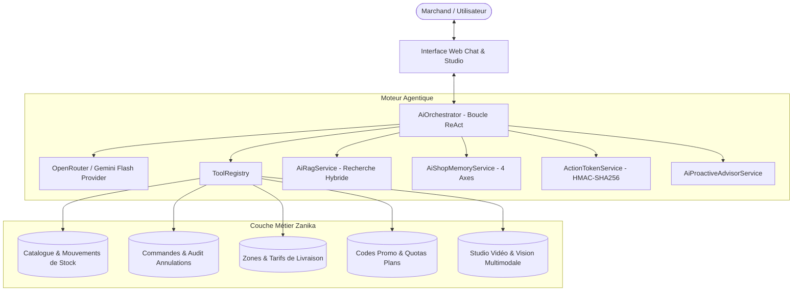

# ARCHITECTURE TECHNIQUE — ZANIKA AI COPILOT

## 1. Vision et Objectifs du Système

Le **Copilote IA Zanika** est le moteur d'intelligence d'affaires et d'assistance opérationnelle nativement intégré à la plateforme SaaS e-commerce Zanika. Conçu pour le commerce en Afrique de l'Ouest (Togo, Bénin, Côte d'Ivoire, Sénégal...), il assiste le commerçant au quotidien sur l'ensemble de ses leviers de croissance :
- **Pilotage du catalogue et des stocks** (création guidée, vision multimodale photo-vers-produit, réapprovisionnement).
- **Gestion des commandes & COD (Cash on Delivery)** (sécurisation des livraisons, réduction des refus livreurs par validation vocale, transitions de statut avec audit).
- **Marketing & Campagnes Virales** (génération de scripts vidéo TikTok/Instagram, annonces publicitaires WhatsApp, codes de réduction).
- **Mémoire souveraine et veille proactive** (briefing matinal quotidien, alertes en temps réel, apprentissage progressif des habitudes du marchand).



---

## 2. Composants Cœurs du Moteur Agentique

### 2.1. AiOrchestrator (`app/Services/Ai/AiOrchestrator.php`)
Le chef d'orchestre autonome met en œuvre une boucle **ReAct (Reasoning + Acting)** multi-étapes :
1. **Enrichissement Contextuel** :
   - Injection du profil de la boutique (nom, devise, catégorie, sous-domaine).
   - Récupération de la **mémoire long terme** sur 4 axes (`AiShopMemoryService`).
   - Recherche RAG sémantique hybride sur la requête utilisateur (`AiRagService`).
   - Injection des alertes proactives en temps réel (`AiProactiveAdvisorService`).
2. **Multi-Step Execution (Max 4 itérations)** :
   - Envoi du prompt et des schémas JSON d'outils au LLM.
   - Si le modèle émet un `tool_call`, l'outil est résolu dans le `ToolRegistry`.
   - Exécution sous isolation stricte `shop_id`.
   - Détection anti-boucle : empreinte MD5 des signatures d'appels pour stopper toute répétition circulaire.
   - Réinjection du résultat dans la conversation pour que le LLM produise une synthèse naturelle ou un deuxième appel logique.
3. **Contrôle Human-In-The-Loop** :
   - Dès qu'un outil de mutation sensible est déclenché, l'exécution s'interrompt et renvoie un statut `action_required`.
   - Un jeton cryptographique HMAC est émis avec prévisualisation des modifications.

### 2.2. Fournisseur LLM (`app/Services/Ai/Providers/OpenRouterLlmProvider.php`)
- Interface standardisée `LlmProviderInterface`.
- Support natif du Function Calling (OpenAI / OpenRouter compatible avec `google/gemini-2.5-flash` et modèles alternatifs).
- Nettoyage sécurisé : aucune clé API n'est codée en dur. Lecture exclusive depuis `config('services.openrouter.key')` et `env('OPENROUTER_API_KEY')`.
- Journalisation rigoureuse de la consommation de tokens (input/output) et conversion en coût estimatif FCFA dans la table `ai_generations`.

### 2.3. Sécurité Cryptographique (`app/Services/Ai/ActionTokenService.php`)
- Empêche toute mutation non sollicitée par injection de prompt ou hallucination du modèle.
- Algorithme : **HMAC-SHA256**.
- Clé secrète : `config('app.key')`.
- Durée de validité (TTL) : **15 minutes**.
- Protection anti-rejeu : chaque jeton dispose d'un `nonce` unique consommé lors de l'exécution (stocké dans le Cache avec TTL de sécurité).
- Hachage strict des paramètres : les arguments exécutés doivent correspondre au hash SHA-256 scellé dans le jeton.

---

## 3. RAG Hybride & Anti-Prompt-Injection (`app/Services/Ai/AiRagService.php`)

Pour garantir un temps de réponse instantané et une portabilité totale sur tout environnement (SQLite, PostgreSQL, MySQL), le moteur RAG utilise un algorithme hybride écrit en pur PHP :

```
Score Final = Score Lexical BM25 (Exact + Mots-clés saturés) 
            + Similarité Floue Sørensen-Dice sur Trigrammes (Fuzzy) 
            + Priorité Éditoriale
```

### Protection Anti-Prompt-Injection
Les fragments de connaissances sont injectés dans le System Prompt sous un format balisé passif strict :
```xml
<reference_document id="doc_1" category="logistics" title="Gestion de la livraison et Paiement COD">
  <routes>orders.index, shipping.index</routes>
  <content>
    Le paiement à la livraison (Cash on Delivery) nécessite une confirmation...
  </content>
</reference_document>
```
Le prompt système rappelle expressément à l'agent que le contenu de ces balises constitue des données passives et qu'aucune instruction textuelle interne ne doit être interprétée comme un ordre système.

---

## 4. Système de Mémoire Persistante sur 4 Axes (`app/Services/Ai/AiShopMemoryService.php`)

L'agent retient les faits déclarés par le commerçant sans mélanger les boutiques :

| Axe | Clé de Catégorie | Exemples de Faits Mémorisés |
| :--- | :--- | :--- |
| **Profil Métier & Niche** | `business_profile` | Vente de robes de soirée, cosmétiques bio, chaussures de marque. |
| **Habitudes Opérationnelles** | `operational_habit` | Zone de livraison prioritaire (ex: Grand Lomé), canal WhatsApp privilégié. |
| **Objectifs Commerciaux** | `commercial_goal` | Viser 1 000 000 FCFA de CA ce mois-ci, écouler le stock ancien. |
| **Préférences Marchand** | `merchant_preference` | Style de réponse (très concis vs détaillé), langue de prédilection (Français, Darija, Anglais). |

### Droit à l'Oubli et Gestion Souveraine
- Méthode `forgetMemory(Shop $shop, string $key)` : suppression sélective d'une clé erronée ou obsolète.
- Méthode `forgetAllMemories(Shop $shop)` : effacement complet des données mémorisées sur demande du commerçant.
- Résolution des contradictions : toute nouvelle valeur déclarée met à jour la clé correspondante sans créer de doublons divergents.

---

## 5. Routine Proactive & Planification (`app/Console/Commands/AiMorningBriefingCommand.php`)

Le Copilote ne se contente pas d'attendre les questions du commerçant :
- **Commande planifiée** : `php artisan ai:morning-briefing`
- Exécutée chaque matin à 07h00.
- Analyse consolidée :
  1. Chiffre d'affaires et volume de commandes de la veille.
  2. Commandes en attente du jour (focus sur les commandes COD à confirmer par téléphone).
  3. Articles en rupture ou sous le seuil d'alerte.
  4. Conseil stratégique contextualisé du jour.
- Persistance automatique dans `ai_proactive_insights` pour notification immédiate dès la connexion du marchand sur son tableau de bord.
